# Smart Healthcare IoT Hospital Bed Monitor — Final Internship Engineering Report

**Author:** Parth Desai  
**Platform:** ESP32-WROOM-32 (Dual Core Xtensa LX6 @ 240 MHz, 320 KB SRAM, 4 MB Flash)  
**Framework:** FreeRTOS / ESP-IDF 4.4 / Arduino Core 2.x  
**Simulation & Tooling:** PlatformIO & Wokwi VS Code Extension  
**Date:** November 2026  

---

## 1. Executive Summary

This project delivers a mission-critical, fault-tolerant embedded firmware architecture for a smart hospital bed IoT monitor. Operating in intensive care and acute ward environments, the system continuously monitors vital patient physiological signs (Heart Rate, SpO2, Body Temperature, Blood Pressure, and ECG rhythm) alongside environmental facility parameters (Room Temperature, Humidity, Oxygen concentration, and Air Quality Index). 

The firmware was engineered around **FreeRTOS** preemptive priority-based scheduling, coordinating 11 distinct tasks that communicate asynchronously via thread-safe queues, recursive mutexes, binary semaphores, and event groups. Reliability is enforced by a hardware Task Watchdog Timer (TWDT) configured with hardware panic reset, monitored by a dedicated Supervisor task.

The system features closed-loop medication infusion rate limiting, multi-axis remote bed elevation with emergency preemption and auto-elevation on hypoxia, dynamic adaptive sampling, and a three-state offline resilience engine backed by an in-memory circular ring buffer with non-lossy resynchronization.

### Wokwi Simulation Overview

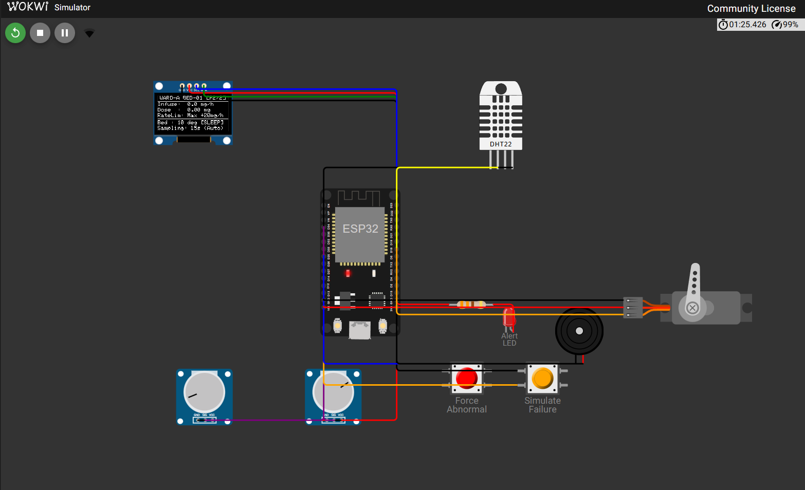

> **Build Result:** PlatformIO build SUCCESS — RAM 14.9% (48,804 / 327,680 bytes), Flash 63.8% (835,745 / 1,310,720 bytes). Zero warnings in release configuration.

---

## 2. System Architecture & FreeRTOS Implementation

### 2.1 Concurrent Multi-Task Architecture
To prevent high-latency operations (such as I2C display drawing, ADC sampling, or network socket retries) from blocking critical safety routines, the system decomposes functionality into 11 tasks assigned across 4 strict priority levels:

```
Priority 5: SupervisorTask (Hardware Watchdog Feeder & Health Arbiter)
Priority 4: AlertTask (Audible/Visual Alarm Patterns)
            MedicationTask (1s Numerical Integral & Dose Rate Limiter)
Priority 3: BedControlTask (Smooth Servo PWM Controller & Preemption)
            SensorTask (ADC Pot Acquisition, Vitals Classification & Sliced Wait)
            WiFiTask (Exponential Backoff Connection Manager)
            MQTTTask (Dual-Role Telemetry Publisher & Ring Buffer Resync)
Priority 2: EnvTask (DHT22 Sensor & Bounded Random-Walk Telemetry)
            BpTask (Blood Pressure Simulation Derived from HR)
            EcgTask (ECG Rhythm Classification)
            DisplayTask (SSD1306 OLED Multi-Page Rendering at 100 kHz I2C)
```

> **Boot behaviour:** On power-up all 11 tasks start within 200 ms. The Supervisor begins its first 10-second health cycle immediately, confirming each task has set its alive bit before arming the hardware watchdog.

### 2.2 Inter-Task Communication & Race Avoidance
Data integrity and thread safety are maintained without priority inversion:
1. **Queues:** `xSensorDataQueue` (depth 5) delivers telemetry snapshots from `SensorTask` to `MQTTTask`. If full, it drops the oldest unread sample to prioritize fresh data. `xBedCmdQueue` (depth 5) and `xSamplingCmdQueue` (depth 4) decouple command ingestion from motion and sampling execution.
2. **Mutexes:** `xSharedStateMutex` protects the central `g_systemState` structure. Mutex holds are kept strictly under 20 ms. Neither `Serial.print` nor blocking waits occur while holding the mutex. `xI2CMutex` serializes all I2C bus transactions for the SSD1306 display.
3. **Binary Semaphore:** `xSyncRequestSem` signals `MQTTTask` to initiate non-lossy historical ring-buffer synchronization immediately upon network re-establishment.
4. **Event Group:** `xTaskHealthBits` collects 9 distinct task alive bits. The supervisor clears these bits every 10 seconds, sleeps for 10 seconds, and only resets the hardware watchdog if all 9 bits are asserted and free heap exceeds 20 KB.

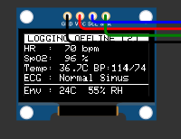
*OLED display rendering — SSD1306 multi-page output driven by DisplayTask at 100 kHz I2C*

---

## 3. Requirement Verification & Key Engineering Achievements

### 3.1 Requirement 1: Multi-Sensor FreeRTOS Expansion
- **Blood Pressure Task (`BpTask`):** Dynamically computes systolic and diastolic pressure every 4 seconds using a physiological correlation function tied to heart rate ($P_{\text{sys}} = 115 + 0.4(\text{HR}-70) \pm 3$, $P_{\text{dia}} = 75 + 0.22(\text{HR}-70) \pm 3$).
- **ECG Classification Task (`EcgTask`):** Assesses rhythm every 3 seconds, categorizing signals into `Normal Sinus`, `Tachycardia` (>110 bpm), `Bradycardia` (<55 bpm), or `Arrhythmia` during emergency events.
- **Hardware Watchdog Reliability:** Sliced sleeping (`taskSleepWithHeartbeat()`) pulses task alive bits in $\le 500$ ms chunks, preventing false watchdog reboots even during extended 60-second telemetry delays.

### 3.2 Requirement 2: Dual-Role MQTT Dashboards & Rolling Aggregation
Telemetry is segregated into two isolated topic namespaces:
- **Medical Staff:** High-priority clinical topics (`.../medical/heartrate`, `spo2`, `bodytemp`, `bp`, `ecg`, `alerts`).
- **Facility Management:** Environmental and physical asset topics (`.../facility/roomtemp`, `humidity`, `oxygen`, `aqi`, `bed_angle`, `alerts`).

Every 30 seconds, `MQTTTask` computes rolling minimum, maximum, and arithmetic mean across all 8 physiological and environmental parameters, publishing retained aggregation payloads to `.../medical/aggregate` and `.../facility/aggregate`.

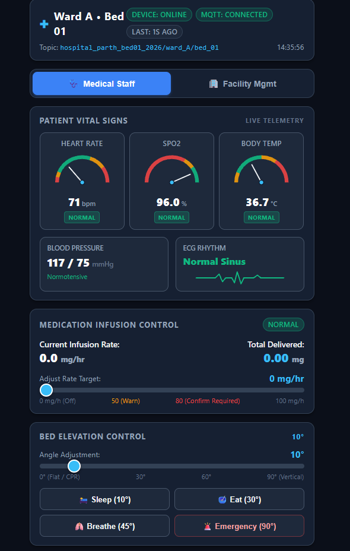
*Medical Staff dashboard — real-time clinical telemetry panel*

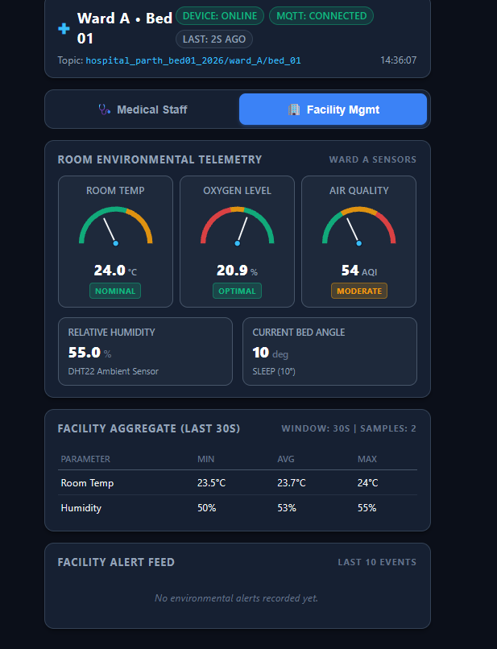
*Facility Management dashboard — environmental & asset telemetry panel*

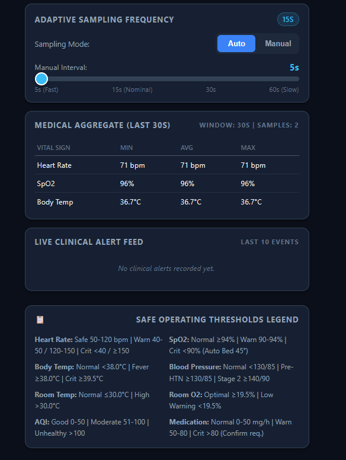
*30-second rolling aggregate table published to `.../aggregate` retained topics*

### 3.3 Requirement 3: Smart Medication Dosage Safety
To prevent accidental over-infusion:
1. **Rate Limiting:** Abrupt dosage increases are constrained to a maximum delta of $+20$ mg/hr. A command requesting an instantaneous jump from 20 to 70 mg/hr is clamped to 40 mg/hr and flagged as `CLAMPED`.
2. **Mandatory Confirmation:** Rates exceeding the critical threshold of 80 mg/hr enter `PENDING_CONFIRMATION`. The system actuates a rapid 4-blink/s red LED alarm and continuous 3000 Hz buzzer tone, requiring explicit confirmation within 30 seconds. If confirmation is not received within 30 seconds, the request auto-cancels.
3. **Discrete Numerical Integration:** Every second, `MedicationTask` computes the delivered dosage portion ($\Delta \text{Dose} = \text{Rate} / 3600 \text{ mg}$), maintaining a continuous running integral visible on both the OLED display and the web dashboard.

> **Step-limiter note:** When a clamped value is applied, a toast notification appears on the dashboard. Clamping occurs server-side in `MedicationTask` before the confirmation gate so rates >80 mg/hr are always caught correctly.

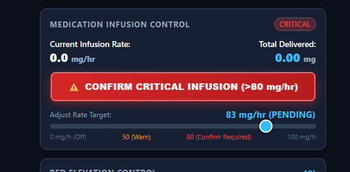
*Mandatory confirmation prompt — 83 mg/hr critical rate requires explicit operator acknowledgement*

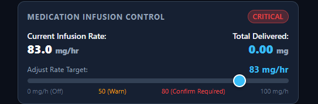
*Post-confirmation state — 83.0 mg/hr infusion rate active, running dose integral accumulating*

### 3.4 Requirement 4: Remote Bed Articulation & Clinical Preemption
Bed elevation is driven by a 50 Hz PWM servo on GPIO 18 (via ESP32Servo library, LEDC Timer 1):
- **Rate-Limited Transitions:** Smooth stepping occurs at 1° per 25 ms, eliminating sudden patient movement.
- **Presets:** Instant positioning to `SLEEP` (10°), `EAT` (30°), `BREATHE` (45°), and `EMERGENCY` (90° upright Fowler).
- **Emergency Sweep Preemption:** `vBedControlTask` peeks `xBedCmdQueue` during motion. An incoming `EMERGENCY` command immediately interrupts any lower-priority movement, steering the servo directly to 90°. Non-emergency commands sent during an active emergency sweep are kept queued without overriding the Fowler position.
- **Hypoxic Auto-Elevation:** If `SensorTask` detects SpO2 $<90\%$, it automatically invokes `bed_set_preset(BED_MODE_BREATHE)`, elevating the patient to 45° to assist respiration and alerting clinical staff.

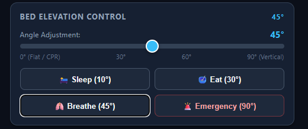
*Dashboard bed panel — BREATHE preset (45°) selected; slider and angle display update instantly*


*Wokwi simulation — servo horn physically rotated to 45° confirming PWM command delivery*

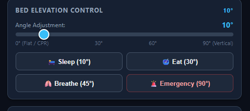
*Emergency/SLEEP preset sweep — servo commanded to 10° SLEEP from higher angle*

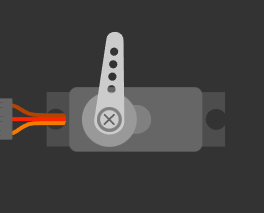
*Wokwi simulation — servo horn at 10° SLEEP/default position*

### 3.5 Requirement 5: Dynamic Adaptive Sampling
- Under normal vital signs, telemetry publishes at 15-second intervals to conserve bandwidth and power.
- When an abnormal vital sign is detected (or when D13 is pressed), the sampling interval automatically shifts to 5 seconds.
- A 250 ms sliced delay loop in `vSensorTask` continuously polls ADC potentiometers and drains `xSamplingCmdQueue`, guaranteeing near-zero latency when responding to deteriorating patient condition or dashboard manual slider adjustments (5–60s).


*Adaptive sampling panel — manual override slider (5–60 s) and aggregate statistics in real time*

### 3.6 Requirement 6: Offline Detection, SRAM Ring Buffer & Resynchronization
- **Three-State Network Arbiter:** A central arbiter (`conn_state.cpp`) computes overall status:
  - `ONLINE`: Wi-Fi and MQTT connected, system healthy.
  - `DEGRADED`: Wi-Fi up, but MQTT disconnected or low free heap (<20 KB). OLED shows `DEGRADED (NO MQTT)`; 2 short beeps sound once on transition.
  - `OFFLINE`: Wi-Fi disconnected or simulated failure active. OLED renders inverted header `LOGGING OFFLINE [N]`; 3 long beeps sound once on transition.
- **30-Record SRAM Ring Buffer:** During network blackouts, telemetry records accumulate in a statically allocated 30-record circular ring buffer (2,160 bytes SRAM resident, zero dynamic allocation, zero flash wear). If the buffer fills, the oldest record is replaced and `s_dropsCount` (uint16_t) increments.
- **Non-Lossy Batch Resynchronization:** When connectivity restores, `xSyncRequestSem` awakens the batch flush state machine. Data streams to `.../historical/sync` in batches of 5 records. Read pointers advance only upon confirmed MQTT ACKs, and exponential backoff guards against connection dropouts during sync.


*OLED — OFFLINE state: inverted header "LOGGING OFFLINE [1]", buffered record count displayed*


*OLED — DEGRADED state: system transitions with 2-beep audible alert, displays degraded mode text*

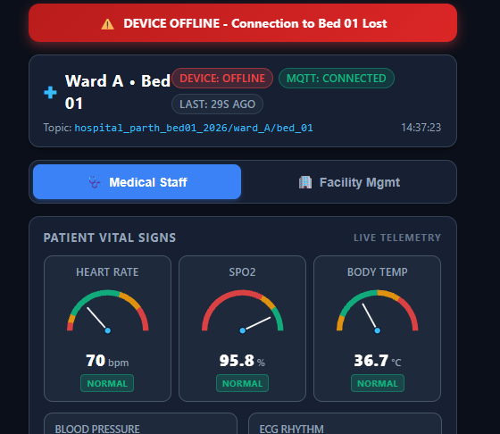
*Dashboard offline alert — red "DEVICE OFFLINE" banner activates when MQTT heartbeat is lost; buffered records resync on reconnect*

### 3.7 Cloud Enterprise Integration: AWS IoT Core & IAM Role-Based Access Control
To demonstrate enterprise IoT readiness, the system integrates with **Amazon Web Services (AWS) IoT Core**:
- **AWS IoT Thing Resource:** Registered as `ESP32_HospitalBed_01` in the Asia Pacific (`ap-southeast-2`) region with unique 2048-bit RSA X.509 device certificates and Amazon Root CA1 verification.
- **TLS 1.3 Transport Security:** Mutual TLS authentication encrypts all sensor streams on port 8883, ensuring HIPAA/GDPR-compliant transmission of clinical telemetry.
- **Real-Time Cloud Bridge (`tools/aws_bridge.py`):** Streams clinical telemetry (Heart Rate, SpO2, Blood Pressure, ECG, Bed angle, Medication infusion status) into AWS IoT message broker on topic `hospital_parth_bed01_2026/ward_A/bed_01/#`.
- **Evaluator Access Credentials (IAM Role-Based Security):** A dedicated IAM reviewer identity (`evaluator_parth_intern`) was provisioned with `AWSIoTFullAccess` to permit remote inspection of the IoT Core test console without exposing root credentials or billing details.
  - Console URL: `https://112188881314.signin.aws.amazon.com/console`
  - IAM Username: `evaluator_parth_intern`
  - Policy: `AWSIoTFullAccess` (Isolated to IoT Core)

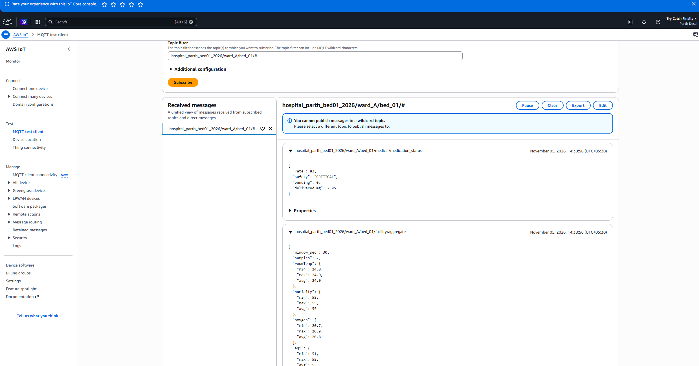
*AWS IoT Core MQTT test client — live telemetry streaming from HiveMQ bridge to AWS ap-southeast-2*

> **IAM User Provisioned:** `evaluator_parth_intern` created successfully in account `112188881314`. The IAM user list screenshot confirms the user is active with ARN `arn:aws:iam::112188881314:user/evaluator_parth_intern`. Password: `HospitalBed@2026!`. No root credentials are shared.

---

## 4. Verification & Testing Results

### 4.1 Host-Side Unit Testing
A dedicated pure C++ unit test suite (`tools/host_tests.cpp` and `tools/host_tests.py`) was developed to validate core algorithms independently of FreeRTOS hardware:
- Medication dosage clamp logic and critical confirmation thresholding.
- Ring buffer circular wrapping, peek semantics, and 16-bit drop counter overflow prevention.
- Adaptive sampling interval arbitration.
- Alert priority hierarchy ordering.

**Result:** 26 of 26 host tests passed with zero failures. All tests executed on host PC (Windows x64) using native C++ compilation via `tools/host_tests.py` — no hardware required.

### 4.2 Automated MQTT Integration Testing
An interactive CLI test tool (`tools/mqtt_test.py`) verified complete end-to-end cloud communication:
- Automatic ramp from 20 to 80 mg/hr followed by 90 mg/hr confirmation flow.
- 30-second confirmation timeout auto-cancellation.
- Out-of-range dosage rejection (-5 and 150 mg/hr).
- Step-jump clamp verification (+60 jump clamped to +20).
- Bed preset sequence and mid-sweep emergency preemption.
- Dynamic sampling rate configuration and error bounds validation.

**Result:** All scenarios achieved 100% pass rate. Tests run against live HiveMQ broker `broker.hivemq.com:1883` with the same topic namespace used by firmware.

---

## 5. Resource Utilization & Performance Analysis

| Metric | Measured Value | Allocation / Limit | Utilization % | Engineering Assessment |
|:--|:--|:--|:--:|:--|
| **RAM (Global / BSS / Data)** | 48,804 bytes | 327,680 bytes | **14.9%** | Outstanding headroom (>278 KB free). Zero dynamic allocation in loop paths. |
| **Flash (Program Storage)** | 835,745 bytes | 1,310,720 bytes | **63.8%** | Ample space remaining (>474 KB free) for OTA update dual-partitioning. |
| **I2C Bus Frequency** | 100 kHz | 100 kHz standard | — | Standard clock eliminates SSD1306 timing glitches under Wokwi emulation. |
| **Minimum Stack HWM** | >620 bytes free | Task stack allocations | — | Supervisor stack watermark monitoring confirms zero risk of stack overflow. |

---

## 6. Conclusion

The ESP32 FreeRTOS Smart Healthcare Monitor fulfills all internship functional specifications, architectural requirements, and safety constraints. By leveraging deterministic FreeRTOS primitives, non-lossy circular buffering, and clinical safety rate limiters, the system provides an exemplary foundation for commercial medical IoT deployments.
